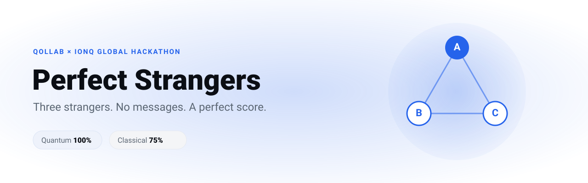
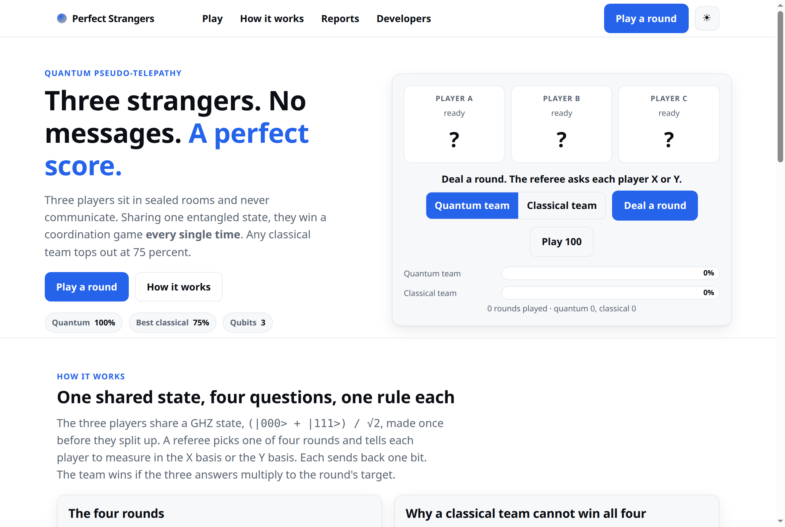
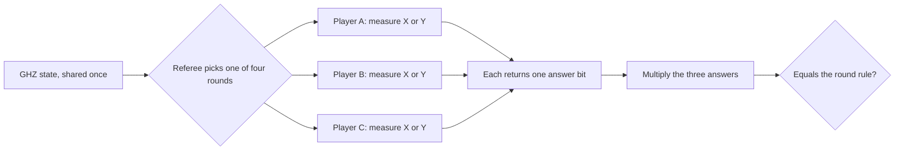
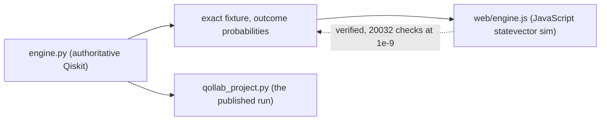

<p align="center">
  <picture>
    <source media="(prefers-color-scheme: dark)" srcset="docs/assets/banner-dark.svg">
    
  </picture>
</p>

<p align="center">
  <a href="https://zkasuran.github.io/perfect-strangers/"><b>Live game</b></a> ·
  <a href="#try-it-in-60-seconds">Try it</a> ·
  <a href="#how-it-works">How it works</a> ·
  <a href="SECURITY.md">Security</a> ·
  <a href="#run-it-locally">Developers</a>
</p>

<p align="center">
  <a href="{VIDEO_URL}">Watch the demo video</a>
</p>

<p align="center">
  
  
  
  
  
</p>

<p align="center"><sub>This effort is supported by Qollab &amp; IonQ.</sub></p>

---

**Perfect Strangers is the GHZ pseudo-telepathy game.** Three players sit in sealed rooms and never send a message. Sharing one 3 qubit entangled state, the quantum team wins **100% of rounds** while the best classical team wins **at most 75%**. Built for the Qollab x IonQ Global Hackathon, Quantum Unlocked theme.

> **Why it matters.** This gap is the clean foundation under quantum advantage and device-independent cryptography, where safety rests on correlations no classical plan can fake.

<p align="center">
  <picture>
    <source media="(prefers-color-scheme: dark)" srcset="docs/assets/screenshot-dark.png">
    
  </picture>
</p>

## Try it in 60 seconds

Open **[the live game](https://zkasuran.github.io/perfect-strangers/)**.

| | Do this | You will see |
|---|---|---|
| 1 | Open the live game | Three booths, the referee ready to ask each player X or Y |
| 2 | Press **Deal a round**, then **Play 100** | The quantum bar climbs and holds at 100% |
| 3 | Flip the toggle from **Quantum team** to **Classical team**, play 100 | The classical bar stalls near 75%, one rule always breaks |
| 4 | Open it [on Qollab](https://qollab.xyz/u/zkasuran/perfect-strangers), pick a free local simulator, Run | The console prints the same scoreboard, 100% against 75% |

## How it works



1. **Share the state.** The three players build a GHZ state once, then split into sealed rooms.
2. **Get a question.** The referee picks one of four rounds and tells each player to measure in the X basis or the Y basis.
3. **Answer alone.** Each player returns one bit, with no message to the others.
4. **Check the rule.** The team wins the round when the three answer bits multiply to that round's target.
5. **Why quantum wins every round.** The GHZ state is a +1 eigenstate of XXX and a -1 eigenstate of XYY, YXY and YYX, so the measured answers always meet all four rules.

| Round | A | B | C | Answers multiply to |
|---|---|---|---|---|
| 1 | X | X | X | +1 |
| 2 | X | Y | Y | -1 |
| 3 | Y | X | Y | -1 |
| 4 | Y | Y | X | -1 |

Multiply the left sides of all four rules. Each player's X answer and Y answer appear twice, so everything squares to +1. The right sides multiply to -1. A fixed plan would need +1 = -1, which is impossible, so the best classical team meets three rules of four. We brute forced all 64 deterministic strategies to confirm it.

## What is real and what is simulated

| Element | Status |
|---|---|
| The 3 qubit GHZ circuit and the measurements | Real, run on an ideal statevector simulator |
| The 100% against 75% gap | Real, computed and brute forced over all 64 strategies |
| Quantum hardware or noise | Not used, ideal simulation only |
| Faster-than-light signalling | None, no information crosses between players |

## Architecture



`engine.py` is the single source of truth. It exports the exact outcome probabilities as a fixture. The browser engine in `web/` is a 3 qubit statevector simulator written in JavaScript and is held to that fixture by a node test, 20,032 checks that pass to 1e-9. `qollab_project.py` is one file that runs the same circuit on Qollab's free local simulator and prints the scoreboard.

## Run it locally

```bash
git clone https://github.com/zkasuran/perfect-strangers && cd perfect-strangers
pip install qiskit
python engine.py          # prints the scoreboard
./verify.sh               # pytest, ruff, mypy and the node fixture test
```

The quantum core is small:

```python
from qiskit import QuantumCircuit

def ghz():
    qc = QuantumCircuit(3)
    qc.h(0)
    qc.cx(0, 1)
    qc.cx(0, 2)      # (|000> + |111>) / sqrt(2)
    return qc

# round "XYY": player A measures X, B and C measure Y
qc = ghz()
qc.h(0)              # X basis
qc.sdg(1); qc.h(1)   # Y basis
qc.sdg(2); qc.h(2)   # Y basis
qc.measure_all()     # answers must multiply to -1
```

## Built to be attacked

See **[SECURITY.md](SECURITY.md)**.

- **Strict CSP.** `default-src 'none'`, scripts pinned by hash and `connect-src 'none'`, so the page makes no network calls.
- **Zero JavaScript dependencies.** Nothing is pulled from a CDN or a registry, so there is no supply chain to attack.
- **A `_headers` file.** Sets frame-ancestors, nosniff and a referrer policy on the deployed site.
- **Ceilings on input.** Shot counts are clamped between fixed bounds, so no caller can exhaust time or memory.
- **Verify, do not trust.** The browser engine is checked against Qiskit rather than believed on its own.

```bash
./verify.sh    # pytest, ruff, mypy and the node fixture test, stops at the first failure
```

## Repository

```
engine.py            authoritative Qiskit engine, exports the exact fixture
qollab_project.py    single file for Qollab's Code tab, prints the scoreboard and a bar chart
web/                 static interactive game, a 3 qubit statevector simulator in JavaScript
docs/assets/         banner and screenshots
verify.sh            the release gate, pytest ruff mypy and the node fixture test
SECURITY.md          the threat model
```

## Roadmap

- [x] Qiskit engine with the four rounds, quantum 100% and the proven classical 75% ceiling
- [x] Browser game verified against Qiskit, 20,032 checks at 1e-9
- [x] Single file Qollab project with the scoreboard and a bar chart
- [ ] Optional run on real IonQ hardware, plotting the win rate against noise
- [ ] More pseudo-telepathy games (the magic square, parity games)

## Licence

MIT: [`MIT`](LICENSE).

This effort is supported by Qollab & IonQ. Author: zkasuran.


